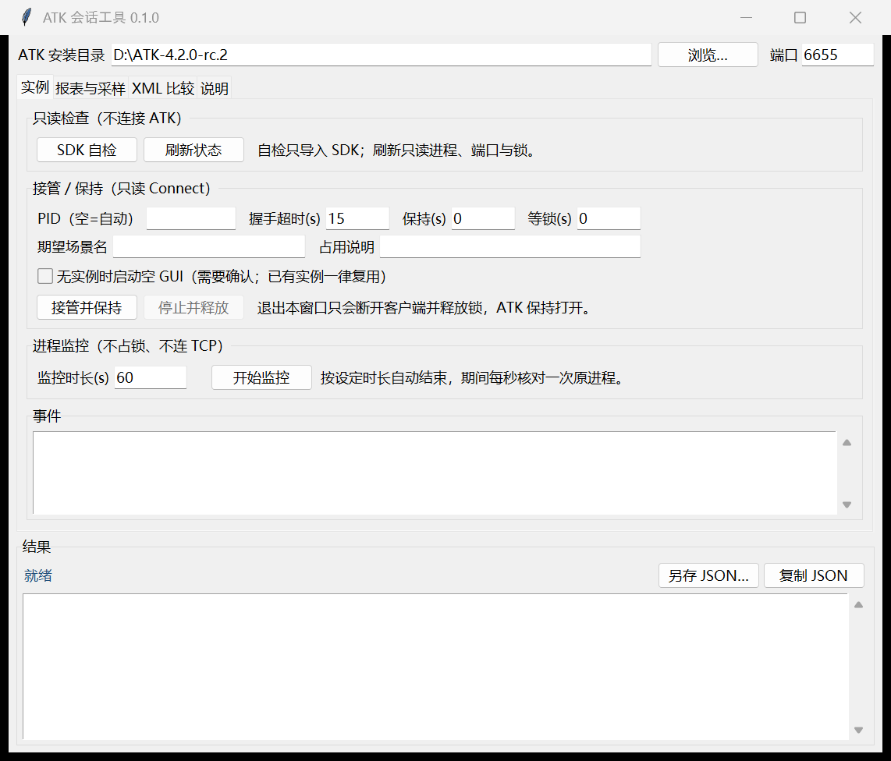
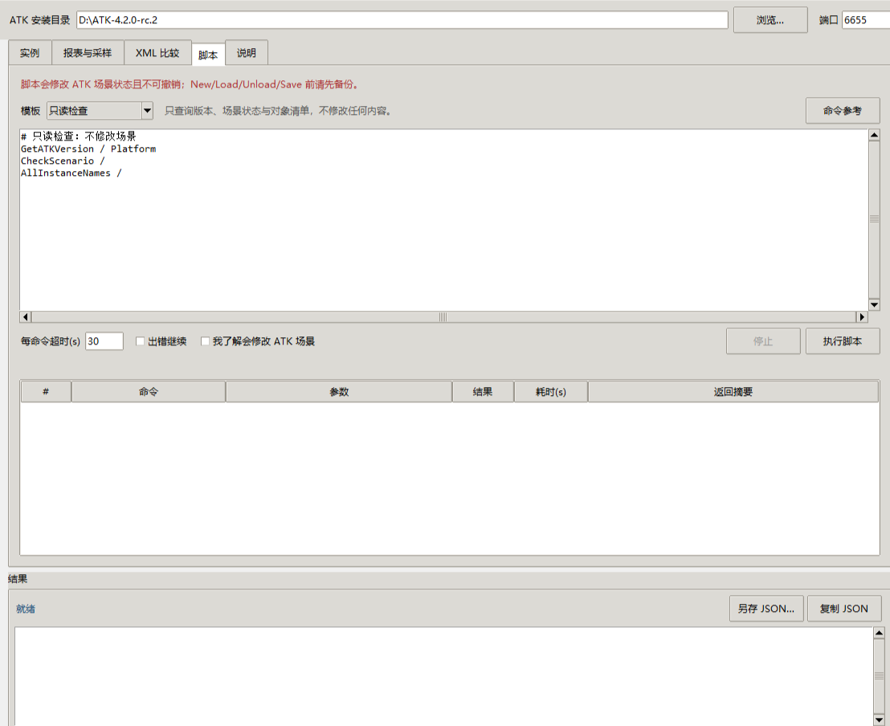

<div align="center">

# ATK 会话工具

**接管本机已运行的 ATK 实例：查询状态、保持会话、监控进程、执行 Connect 脚本，并离线校验导出文件。**

`atkcli` · Windows x64 · Python 3.12 · v0.1.0


[功能特性](#功能特性) · [快速开始](#快速开始) · [图形界面](#图形界面) · [命令行](#命令行) · [脚本执行](#脚本执行) · [退出码](#退出码)

</div>



## 为什么需要它

ATK 的仿真往往要跑很久。中途想知道“软件还活着吗”“这个场景是不是我刚才那个”，
直接再开一个 Connect 客户端会和已有连接、已有脚本抢同一个实例；
任务卡住时，又很难区分是进程还在计算，还是进程已经消失。

`atkcli` 把这件事收敛成一套有边界的操作：**先核验进程身份，再获取实例锁，最后才握手**。
只读命令随时可查；会修改场景的命令必须显式执行脚本，并二次确认。

## 功能特性

- **双入口**：Tkinter 图形界面 + 完整命令行，共用同一套会话与锁逻辑
- **身份核验**：核对进程名、可执行文件路径、当前账户、PID、创建时间与端口归属
- **独占租约**：`%TEMP%\atkcli.lock` 文件锁，支持有界排队，异常退出自动释放
- **只读优先**：状态、平台版本、场景名查询不会修改场景
- **可停止的监控**：约 0.4 秒探活，进程消失立即报告 `DEAD`，不受 SDK 阻塞影响
- **Connect 脚本**：逐条执行并返回 `RESULT` / `NACK` / 耗时，支持 `sleep` 与超时
- **离线校验**：报表解析、采样间隔核验、XML 数值比较，不依赖 ATK 在线
- **自动化友好**：统一 JSON 输出与语义化退出码，`--dry-run` 只预览不执行

## 快速开始

### 从源码安装

需要 Windows x64 与 Python 3.11+；**接管真实实例需要 CPython 3.12**（厂商 SDK 限制）。

```powershell
git clone https://github.com/<owner>/atkcli.git
cd atkcli
py -3.12 -m venv .venv
.\.venv\Scripts\Activate.ps1
pip install -e .
atkcli doctor
```

`doctor` 只导入 SDK，不启动 GUI、不建立 TCP 连接。ATK 默认目录为 `D:\ATK-4.2.0-rc.2`，
可用 `--atk-home` 或环境变量 `ATK_HOME` 覆盖；端口默认 `127.0.0.1:6655`。

### 接管已有实例

```powershell
atkcli instance status
atkcli instance attach --timeout 20 --out session.json
atkcli instance attach --resume session.json --hold 120 --log session-1.jsonl
```

`attach` 成功后返回包含 PID、创建时间、场景名与握手时间的 JSON。
`--resume` 只接回回执里的那一个进程；原进程已退出时返回 `DEAD`，不会跟随新实例。

### 打开图形界面

```powershell
python -m atkcli.gui
```

也可以直接运行打包目录中的 `ATK会话工具.exe`。

## 图形界面

| 页签 | 用途 |
|---|---|
| 实例 | SDK 自检、状态刷新、接管/保持、进程监控、启动空 GUI |
| 报表与采样 | 解析地面站报表、核验采样间隔 |
| XML 比较 | 按路径比较两份 XML 的叶节点数值 |
| 脚本 | 编辑并执行 Connect 脚本，查看逐条结果 |
| 说明 | 版本、边界与退出码 |



> 脚本页和 `script run` 是仅有的会修改场景的入口，执行前必须勾选确认。
> `New` / `Load` / `Unload` / `Save` 可能覆盖文件，请先备份。

## 命令行

| 命令 | 说明 |
|---|---|
| `atkcli doctor` | 导入 SDK 自检 |
| `atkcli instance status` | 被动快照：进程、端口监听与锁 |
| `atkcli instance attach` | 核验身份后接管，可保持指定时长 |
| `atkcli instance watch` | 仅用操作系统探活，不建立 Connect |
| `atkcli reports parse` | 解析已导出的地面站报表 |
| `atkcli reports cadence` | 核验相邻时间戳的实际步长 |
| `atkcli xml compare` | 比较两份 XML 的指定叶节点 |
| `atkcli script run` | 逐条执行 Connect 脚本 |

完整参数见 `atkcli <命令> --help`。

### 离线校验示例

```powershell
atkcli reports parse --input examples/ground-station.zh.txt --out downlink.json
atkcli reports cadence --input examples/instrument.csv --step 60
atkcli xml compare --before examples/display.before.xml --after examples/display.after.xml --path Display/Scale --numeric
```

## 脚本执行

脚本每行一条 `命令名 参数`，`#` 开头为注释，`sleep 秒数` 在两条命令之间等待：

```text
# 只读检查
GetATKVersion / Platform
CheckScenario /
sleep 0.5
AllInstanceNames /
```

```powershell
atkcli script run --input demo.txt --command-timeout 60
```

- `--command-timeout` 是单条命令的等待上限，超时会断开客户端（ATK 可能仍在执行）
- 默认遇错即停；`--continue-on-error` 才会继续后续命令
- 脚本仍使用同一把实例锁，结束后断开客户端

命令语法见 ATK 本机帮助“二次开发教程 → 二次开发CONNECT模式 → 命令参考”，
GUI 的“命令参考”按钮内置了常用命令。

## 退出码

| 码 | 含义 |
|---:|---|
| 0 | 成功或完成 dry-run |
| 2 | 参数、输入格式、路径或文件读写错误 |
| 10 | 期限内未就绪或未获有效应答 |
| 20 | 原实例消失或 PID 已复用 |
| 21 | 未找到请求接管的实例 |
| 31 | 数据不足或核验未通过 |
| 40 | 其他客户端持锁，等待超时 |
| 41 | 实例/端口/场景归属冲突 |
| 42 | SDK、进程信息权限或握手失败 |
| 130 | 用户中断 |

## 安全边界

- 本工具不包含 ATK、许可证、场景、厂商 DLL 或账户凭据
- 锁只协调使用同一临时目录与同一锁约定的客户端，不能阻止手工操作或其他脚本
- `DEAD` 只表示观测到原进程消失，不能证明是关闭、崩溃还是抢占
- 接管与脚本只使用官方 SDK 的 `atkOpen` / `atkConnect` / `atkClose`
- 离线校验只读取你已导出的文件，不执行 XML 中的任何内容

## 项目结构

```text
atkcli/
├─ src/atkcli/
│  ├─ cli.py          # 命令行入口
│  ├─ gui.py          # Tkinter 界面
│  ├─ session.py      # 会话、租约与握手
│  ├─ channel.py      # SDK 子进程通道
│  ├─ machine.py      # 进程与端口核验
│  ├─ scripting.py    # Connect 脚本解析与模板
│  ├─ reports.py      # 报表解析与采样核验
│  └─ xmlcheck.py     # XML 数值比较
├─ tests/             # 测试
└─ examples/          # 合成样例
```

## 开发

```powershell
.\.venv\Scripts\python.exe -m pytest -q
```

## 兼容性

| 场景 | 要求 |
|---|---|
| 接管/监控真实实例 | Windows x64、CPython 3.12、ATK 4.2.0-rc.2 |
| 仅离线校验 | Python 3.11+ |
| 依赖 | `psutil>=6,<8` |

## 许可证

[MIT](LICENSE)

本项目与 ATK 厂商无隶属关系。ATK 需自行安装并遵守其许可协议。
